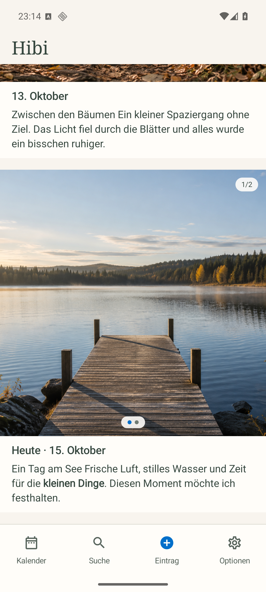
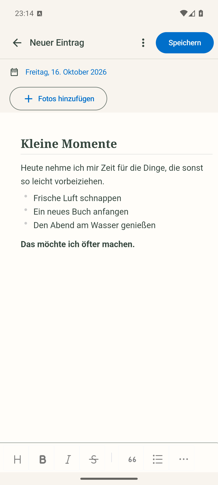
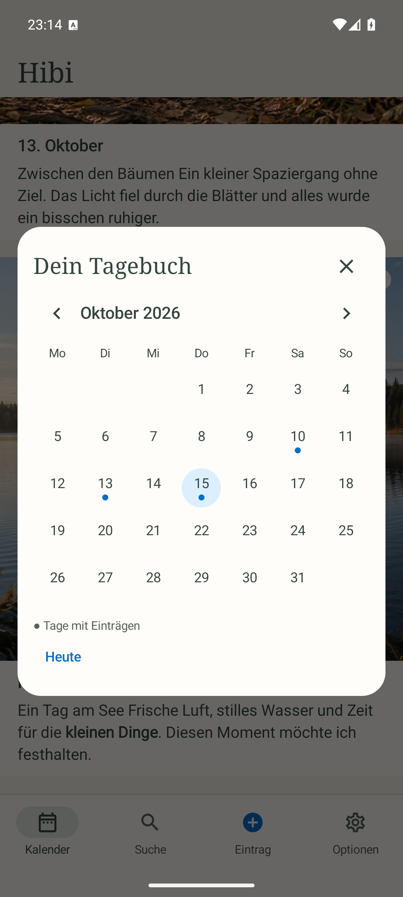

# Hibi [](https://github.com/openai/codex)


**Dein Tagebuch. Bilder, Worte und kleine Momente.**

Hibi ist ein Android-Tagebuch für Fotos und Markdown. Einträge bleiben auf deinem Gerät; portable ZIP-Backups lassen sich über Android speichern, teilen und wieder importieren.

## Einblicke

| Dein Feed | Schreiben | Tage wiederfinden |
| :---: | :---: | :---: |
|  |  |  |

Echte Screenshots aus Hibi 0.2.5 auf einem Pixel-8-Emulator mit Android API 36. Alle Einträge sind erfunden; die beiden Fotomotive wurden mit Imagegen erzeugt. Die Aufnahmen zeigen die unveränderte App einschließlich ihres nativen Markdown-Schreibbereichs.

## Was Hibi kann

- **Fotos, Text oder beides:** mehrere Originalbilder pro Eintrag, als Carousel im Feed.
- **Markdown schreiben:** WYSIWYG-Editor mit Überschriften, Formatierung, Listen, Aufgaben, Zitaten und Links; lokale Entwürfe zum Weiterschreiben.
- **Einträge wiederfinden:** Volltextsuche, Datumsfilter und ein Kalender mit markierten Tagen.
- **Den Feed anpassen:** neueste Einträge standardmäßig unten, umkehrbare Reihenfolge und quadratische Bilder oder Quellformat.
- **Backups mitnehmen:** vollständiger ZIP-Export mit optionalem AES-256-Passwort und geprüfter Importvorschau. Bestehende abweichende Einträge bleiben beim Import erhalten.
- **Ans Sichern denken:** wöchentliche oder monatliche Erinnerung beim Öffnen der App.

Die Oberfläche ist deutschsprachig. Hibi benötigt Android 8.0 / API 26 oder neuer und verwendet keine eigene Kontenanmeldung. Editor und Einträge funktionieren offline; die App deklariert keine Internetberechtigung.

## Backup und Wiederherstellung

Unter **Optionen → ZIP-Backup erstellen** kannst du die ZIP direkt im Android-Dateidialog speichern oder an eine andere App teilen. OneDrive, Google Drive und andere Dokumentanbieter können dort als Ziel dienen. Die gewählte Ziel-App übernimmt ihren Upload.

Backups werden **manuell exportiert**. „Letzter Export“ bezeichnet die gespeicherte Datei beziehungsweise die Übergabe an den Teilen-Dialog; es bestätigt keinen abgeschlossenen Cloud-Upload. Die Erinnerung erscheint beim Öffnen von Hibi.

Die ZIP enthält veröffentlichte Einträge, Originalbilder und Anzeige-/Erinnerungseinstellungen. Entwürfe gehören nicht zum Backup. Bei verschlüsselten ZIPs bleiben Datei- und Ordnernamen sichtbar; das Passwort wird nicht gespeichert. Sichere eine externe ZIP, bevor du die App deinstallierst oder das Gerät wechselst.

Für eine Wiederherstellung wählst du **ZIP-Backup importieren**. Hibi prüft Format, Inhalte und SHA-256-Prüfsummen und zeigt vor der Übernahme eine Vorschau. Details: [Backup-Format](docs/backup-format.md).

## Selbst bauen und installieren

Voraussetzungen: **JDK 21**, **Android SDK Platform 36** und **Build Tools 36**. Der Wrapper lädt Gradle 8.13; beim ersten Build werden die Abhängigkeiten heruntergeladen. Den SDK-Pfad über `ANDROID_HOME` oder eine lokale, nicht versionierte `local.properties` konfigurieren.

```sh
git clone https://github.com/PaulFreund/Hibi.git
cd Hibi
./gradlew :app:assembleDebug
adb install -r app/build/outputs/apk/debug/app-debug.apk
```

Unter Windows `gradlew.bat` verwenden. Der Debug-Build nutzt `org.lvl3.hibi.debug`, die Release-App `org.lvl3.hibi`. Beide können nebeneinander installiert werden. Version dieses Quellstands: **0.2.5**.

Für eine eigene signierte Release-APK werden Schlüssel und Passwörter außerhalb des Repositories konfiguriert. Anleitung: [Entwicklung und Signierung](docs/development.md). Für Updates einer bestehenden Installation muss derselbe Signierschlüssel erhalten bleiben.

## Im Code weiterarbeiten

| Bereich | Inhalt |
| --- | --- |
| [`core/`](core/) | Datenmodelle, Entwürfe, Backup-Format und JVM-Tests |
| [`app/`](app/) | Android-App, SQLite, Compose und der lokale Markdown-Editor |
| [`docs/development.md`](docs/development.md) | Build, Signierung, Tests und wichtige Datenverträge |
| [`docs/backup-format.md`](docs/backup-format.md) | Portables ZIP-Format und Importprüfung |
| [`docs/third-party.md`](docs/third-party.md) | Bibliotheken, Lizenzen und Editor-Prüfsummen |

Hibi verwendet Kotlin, Jetpack Compose, kotlinx.serialization, Zip4j, Markwon und TOAST UI Editor. Die Editor-Assets liegen im Repository; Statistikübermittlung und Netzwerkzugriffe des Editors sind deaktiviert.
